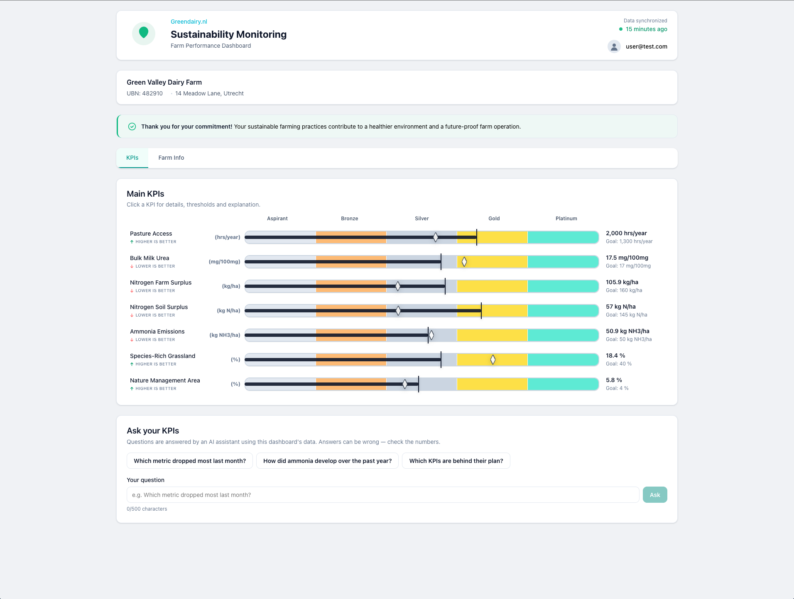

# KPI Dashboard

[](https://github.com/leomacode/kpi-dashboard/actions/workflows/ci.yml)


A sustainability KPI dashboard for agricultural farms, built to demonstrate custom data visualisation, real backend integration, and production-grade frontend engineering.

**Live demo:** <a href="https://kpi-dashboard-six-theta.vercel.app" target="_blank">kpi-dashboard-six-theta.vercel.app</a>

> No setup required. The app falls back to sample data automatically if Supabase is not configured.

---

## Highlights

- **Custom bullet chart** — built without a chart library, using a fixed 5-tier system where each tier always occupies 20% of the bar width
- **Non-linear positioning algorithm** — handles both higher-is-better and lower-is-better KPIs, needle always moves rightward on improvement
- **Optimistic updates** — plan value changes update the UI immediately with server rollback on failure
- **Comprehensive test coverage** — 62 unit tests + 51 Playwright E2E tests across Chromium, Firefox, and WebKit
- **Accessible modal** — keyboard navigation, focus trap, `role="dialog"`, `aria-modal`
- **"Ask your KPIs" AI assistant** — plain-language questions answered by a tool-calling agent over the dashboard's real data, streamed, with every tool call shown

---

## Screenshot



---

## Tech Stack

- **Frontend:** React, TypeScript
- **Styling:** styled-components
- **Backend:** Supabase (PostgreSQL + REST API)
- **Routing:** React Router v7
- **AI:** Vercel AI SDK 7 (tool calling, streaming), Zod, Google Gemini by default (Anthropic and OpenAI supported)
- **Serverless:** Vercel Functions (`api/`)
- **Testing:** Vitest, Testing Library, Playwright
- **Build:** Vite

---

## Overview

Farmers enrolled in sustainability programs track performance across KPIs — pasture access, nitrogen surplus, ammonia emissions, and more. Each KPI has a 5-tier scoring system (Aspirant → Platinum) with directional logic (higher-is-better vs lower-is-better).

The dashboard visualises those KPIs using a custom bullet chart, allows farmers to set target plan values, and persists changes to a real backend.

---

## Features

- **Custom bullet chart** — fixed 5-tier visual system, each tier always 20% of bar width regardless of numeric range
- **Bidirectional KPI logic** — correctly handles higher-is-better and lower-is-better KPIs
- **Real backend** — Supabase integration with optimistic updates and rollback on failure
- **Mock data fallback** — app always works without a configured backend
- **Interactive modal** — detail view with tier, plan value editor, thresholds, and explanation
- **Error boundary** — catches render errors and shows a recoverable fallback UI
- **Ask your KPIs** — chat panel below the KPI card; see the next section

---

## Ask your KPIs (AI assistant)

A chat panel on the KPI page. Ask a question in plain language — _"Which metric dropped most last month?"_, _"Which KPIs are behind their plan?"_, _"Compare nitrogen farm surplus in Q1 with Q3"_ — and get a streamed answer grounded in the dashboard's data. Under each answer, **Show the work** lists every tool the agent called, with its input and a one-line result, so every number can be traced back to the data.

### How it works

```
Browser (AskKpisPanel)                 Vercel Function (api/ask.ts)
──────────────────────                 ──────────────────────────────────────────
useChat ── POST plain-text history ──▶ validate (Zod) · rate limit · size limits
                                              │
                                              ▼
                                       streamText (agent loop, max 8 steps)
                                       ┌──────────────────────────────────┐
                                       │ model decides ──▶ tool call      │
                                       │      ▲               │           │
                                       │      └── tool result ┘           │
                                       │ … until it can answer            │
                                       └──────────────────────────────────┘
                                              │
◀──────── UI message stream (SSE) ────────────┘
text + tool-call parts → answer + "Show the work"
```

The model never sees the database directly. It can only call typed tools that read the same KPI data as the dashboard (Supabase when configured, otherwise the bundled mock data), so the numbers it states come from tool results, not from its training data.

### Tools

All tool inputs are defined with Zod; the SDK validates every call before it runs. Every tool returns a `summary` line, which is what the "Show the work" panel displays.

| Tool | Input | Returns |
|---|---|---|
| `listMetrics` | optional `directionality`, `tier` filters | id, unit, directionality, current value, plan, tier, and the month range with data |
| `queryMetric` | `metric` (id or name), optional `from` / `to` month | monthly values in range, plus current value, plan and tier |
| `comparePeriods` | `periodA`, `periodB` (month ranges, averaged), optional `metrics` | change, % change and an `improved / worsened` verdict that respects directionality, sorted by biggest relative drop |

`comparePeriods` covers all metrics in one call when `metrics` is omitted. Before it existed, "which metric dropped most" took seven `queryMetric` calls; now it takes one.

### Data

Each KPI has 12 months of history (`kpi_history`, Nov 2025 – Oct 2026), and the last month always equals the KPI's current value, so the assistant and the bullet chart never disagree. The mock series in `mockHistory.ts` mirrors the SQL seed.

### Model and fallback

The model is set with `AI_MODEL`, a comma-separated list of `<provider>:<model>` tried in order:

```
AI_MODEL=google:gemini-3.5-flash,google:gemini-3.5-flash-lite   # default
AI_MODEL=anthropic:claude-sonnet-5-5                            # any single model works too
```

Gemini is the default because it has a free API tier. Free quotas are small and per model (`gemini-3.5-flash` allows 20 requests per day), so a model middleware (`wrapLanguageModel`) moves to the next model in the list when one returns 429 (quota used up) or 503 (overloaded). Model versions are pinned rather than `-latest` aliases so behaviour doesn't change under you.

### Security and limits

| Concern | Handling |
|---|---|
| API key | Lives only in the serverless function's environment — never `VITE_`-prefixed, never in the browser bundle |
| Untrusted input | The browser sends plain-text history only; the server never accepts client-supplied tool calls or results. Request body validated with Zod |
| Input size | 500 characters per question, last 10 messages, 64 KB body |
| Abuse | 10 requests per minute per IP (sliding window, returns `429` with `Retry-After`) |
| Runaway agent | Maximum 8 model/tool steps per question |
| Hanging provider | Timeouts: 45 s total, 20 s to first chunk, 15 s between chunks; mid-stream provider errors retried twice |
| Error leakage | Provider errors are logged server-side and replaced with a short message: _usage limit reached_, _service busy_, _took too long_, or a generic error |
| CSP | Unchanged — `/api/ask` is same-origin, so `connect-src 'self'` already covers it |

The rate limiter is in memory, so each serverless instance counts separately and a cold start resets it. That is enough to stop casual abuse of a demo; a shared store such as Upstash Redis would be the next step.

### Accessibility

- The conversation is an `aria-live="polite"` list with `aria-busy` while an answer streams
- Errors use `role="alert"` with a **Try again** button
- Focus stays in the question input after asking; **New chat** clears the conversation and returns focus there
- **Show the work** is a native `<details>` / `<summary>`, so it works with the keyboard out of the box
- The panel is lazy-loaded, so the AI SDK stays out of the initial bundle

### In progress

- **Chart generation** — the model returns a chart config validated against a Zod schema compatible with the existing chart components; on a validation error the error is sent back to the model for up to 3 attempts, then a clear error is shown
- **Tests and evals** — unit tests for the tools and the retry loop, Playwright tests with a mocked model stream (no real API calls in CI), and a separate eval script of 10–15 questions with expected tool calls, run against the real API

### What I learned

_To be written._

---

## Architecture

```
api/
└── ask.ts                              # Vercel Function: POST /api/ask (thin entry point)
server/
└── ai/
    ├── handler.ts                      # Request validation, rate limit, streaming, error mapping
    ├── agent.ts                        # Instructions, streamText agent loop, step limit, timeouts
    ├── tools.ts                        # listMetrics, queryMetric, comparePeriods (Zod inputs)
    ├── model.ts                        # AI_MODEL parsing, provider registry, quota fallback
    ├── data.ts                         # Server-side KPI + history load (Supabase or mock)
    └── rateLimit.ts                    # In-memory sliding-window limiter
src/
├── components/
│   ├── KPISection/
│   │   ├── KPISection.tsx              # Data fetching, state management
│   │   ├── BulletChartRow.tsx          # Individual KPI row with chart
│   │   ├── BulletChartDetailModal.tsx  # Detail view + plan value editor
│   │   ├── BulletChartMarker.tsx       # Diamond SVG marker (plan value)
│   │   ├── bulletChartRangeUtils.ts    # Core positioning algorithm
│   │   ├── mappers.ts                  # Supabase → ViewModel transformation
│   │   ├── types.ts                    # Shared TypeScript types
│   │   └── data/
│   │       ├── mockKpis.ts             # Sample data fallback
│   │       └── mockHistory.ts          # 12 months of history per KPI
│   ├── AskKpis/
│   │   ├── AskKpisPanel.tsx            # Chat panel (useChat, streaming, errors, New chat)
│   │   ├── ShowTheWork.tsx             # Expandable list of tool calls under each answer
│   │   ├── toolSteps.ts                # Tool message parts → display steps
│   │   └── wire.ts                     # Plain-text request payload, error messages
│   ├── Header/
│   ├── FarmBar/
│   ├── Tabs/
│   └── ErrorBoundary.tsx
├── lib/
│   └── supabase.ts
└── unitTests/
    ├── bulletChartRangeUtils.test.ts
    ├── mappers.test.ts
    ├── BulletChartRow.test.tsx
    ├── BulletChartDetailModal.test.tsx
    └── ErrorBoundary.test.tsx
e2e/
└── kpi.spec.ts
```

---

## Key Engineering Decisions

**Why no chart library?**

The bullet chart uses a fixed 5-tier visual system where each segment occupies exactly 20% of the bar width, regardless of numeric distance between thresholds. This non-standard scale doesn't map to any chart library abstraction — building it directly gave full control over the positioning algorithm.

**Bullet chart positioning algorithm**

The marker position is computed in four steps:

1. Determine which tier contains the KPI value
2. Calculate the relative position within that tier
3. Map that fraction onto the fixed 20% tier width
4. Invert the fraction for lower-is-better KPIs, so improvement always moves the needle rightward

**Optimistic updates**

Plan value changes update the UI immediately without waiting for Supabase to confirm. If the write fails, the UI rolls back by refetching server state — the same pattern used by Linear and Notion.

**State ownership**

KPI data is owned in local state within `KPISection`. The component treats local state as source of truth, updated on confirmed server responses. No global state library needed — the data is not shared across unrelated parts of the app.

---

## Engineering Trade-offs

**Local state vs global state**

The KPI data is owned by a single feature and not shared across the app. Introducing Redux or Zustand would add complexity for no practical gain. Local state keeps data flow explicit and easier to reason about.

**SVG vs Canvas for the chart marker**

The chart uses simple primitives (diamond marker, needle line) that benefit from DOM-level accessibility and CSS integration. SVG allows responsive layouts, styled-components styling, and accessibility attributes without the overhead of canvas rendering.

**styled-components vs Tailwind**

styled-components reflects real production experience from Be Informed, keeps styles co-located with components, and suits a project where each component is self-contained.

---

## Performance

- **No chart library** — visualisation built from styled divs and SVG primitives, keeping bundle size small
- **Memoised calculations** — segment generation and needle positioning run inside `useMemo`, scoped per row
- **Isolated row components** — plan value change only re-renders the affected row and modal
- **Stable callbacks** — event handlers wrapped in `useCallback` to prevent unnecessary child re-renders
- **Optimistic updates** — UI stays responsive while Supabase write happens in the background

---

## Accessibility

- Interactive elements are native `<button>` elements with descriptive `aria-label` attributes
- Detail modal uses `role="dialog"` and `aria-modal="true"`
- Modal traps focus — `Escape` closes, `Enter` confirms, no mouse required
- Tier information conveyed with both colour and text label — colour is never the sole indicator
- Directionality labels rendered with visible text icons alongside colour

---

## Getting Started

### Prerequisites

- Node.js 20+
- _(Optional)_ A Supabase project for plan value persistence

### Installation

```bash
git clone https://github.com/leomacode/kpi-dashboard.git
cd kpi-dashboard
npm install
npm run dev
```

The app runs on sample data by default. No Supabase account needed.

### Enabling Ask your KPIs _(optional)_

1. Get a free Gemini API key at [aistudio.google.com/apikey](https://aistudio.google.com/apikey).
2. Add it to `.env` (never to `.env.example`, which is committed):

   ```
   GOOGLE_GENERATIVE_AI_API_KEY=your-key
   # optional — defaults to google:gemini-3.5-flash,google:gemini-3.5-flash-lite
   AI_MODEL=google:gemini-3.5-flash
   ```

3. Restart `npm run dev`. The dev server serves `/api/ask` itself, so `vercel dev` is not needed.

On Vercel, set the same variables in the project's environment settings. Without a key the dashboard works normally and the panel shows "The AI service is not configured on this deployment."

### Connecting Supabase _(optional)_

Create a `.env` file in the project root:

```
VITE_SUPABASE_URL=https://your-project.supabase.co
VITE_SUPABASE_ANON_KEY=your-anon-key
```

Then run the schema and seed data in your Supabase SQL editor. It creates both `kpis` and `kpi_history` (the monthly data used by Ask your KPIs). See [`supabase/schema.sql`](./supabase/schema.sql).

---

## CI / Quality Gates

GitHub Actions runs on every push to `master` and every PR:

- **Static gate** — lint, typecheck, unit tests (62), production build.
- **E2E gate** — Playwright tests, sharded for speed.
  - **Pull request:** Chromium only, 2 parallel shards (~3 min).
  - **Push to master:** Chromium + Firefox + WebKit, each 2 shards (~5 min, 6 parallel runners).
- Browser binaries cached per Playwright version → cache hits skip ~60s/shard.
- `npm run preview` serves the built `dist/` artifact from the static gate — no rebuild.

Workflow: [`.github/workflows/ci.yml`](./.github/workflows/ci.yml)

---

## Testing

```bash
npm run test          # Unit + component tests
npx playwright test   # 51 E2E tests across Chromium, Firefox, WebKit
```

Unit tests cover: `bulletChartRangeUtils`, `mappers`, `BulletChartRow`, `BulletChartDetailModal`, `ErrorBoundary`.

---

## Code Quality

```bash
npm run typecheck   # Zero type errors
npm run lint        # Zero warnings
npm run build       # Production build
```
